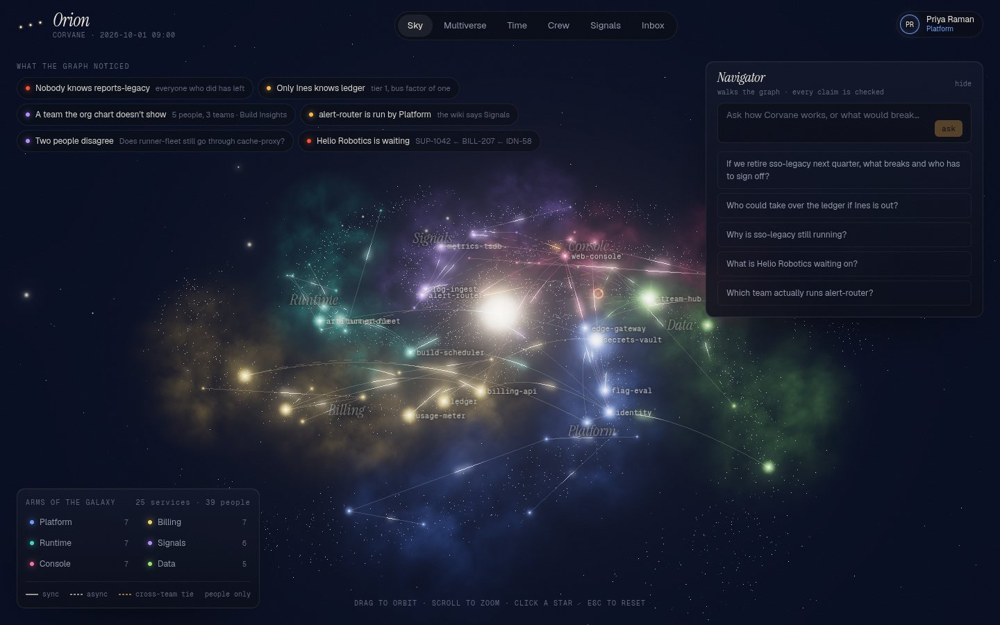
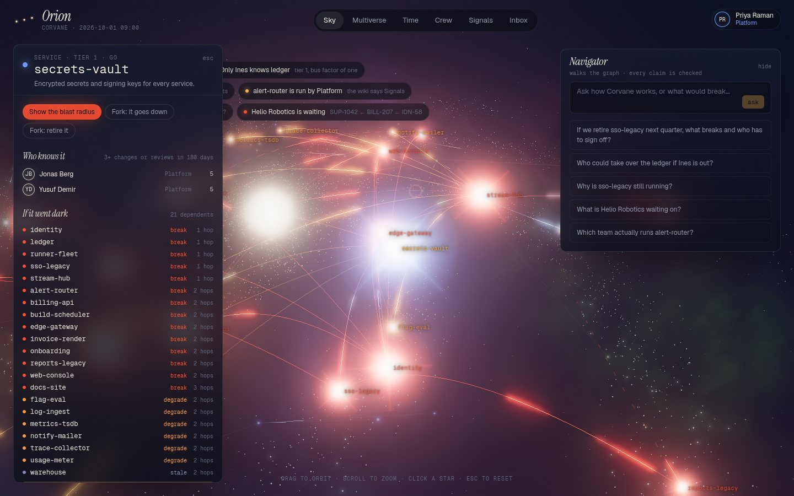
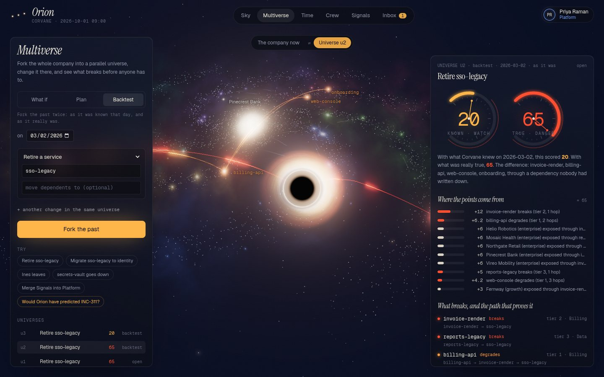
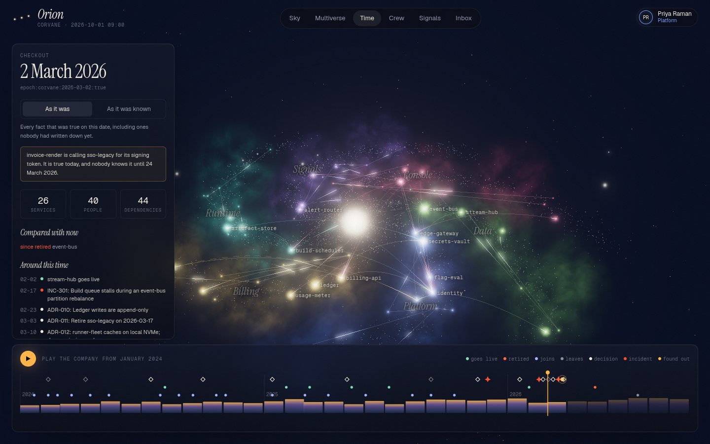
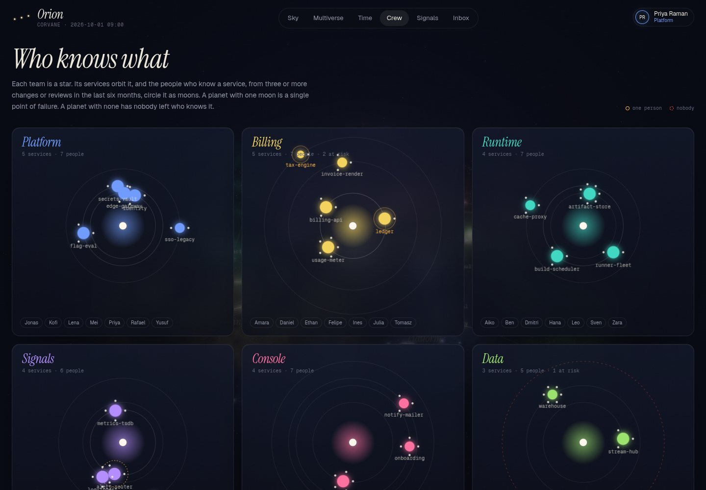
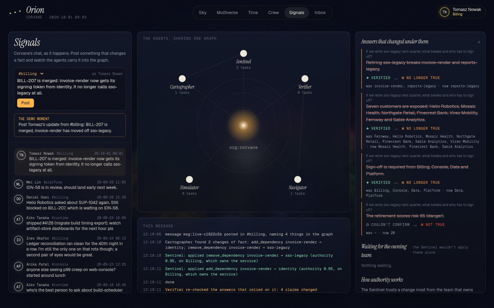

# Orion

**See the company before you change it.**

Orion keeps a company's people, teams, services, decisions and conversations in one [FalkorDB](https://falkordb.com)
graph. Before anyone retires a service, loses a teammate or merges two teams, Orion forks the whole company graph
into a parallel universe, makes the change there, and shows what breaks, who is exposed, who has to agree, and
where every claim comes from. An agent answers questions by walking the graph, and its answers re-check themselves
when the company changes.



## Tracks

Orion is entered in **all three tracks**.

| Track | What Orion does for it |
|---|---|
| **01 Agents That Act on Connected Data** | The Navigator answers by calling graph tools (multi-hop traversal, WCC, betweenness, PageRank, minimum spanning forest, shortest paths) and acts by forking universes. Every sentence it says is a typed claim the graph checks before you see it. The same tools are on an MCP server. |
| **02 Agent Memory and Coordination** | One memory graph per person (episodic turns, versioned beliefs, learned procedures). Agents coordinate on a shared board in its own graph: tasks claimed atomically, chained with `FOLLOWS`. A change one agent applies re-checks the answers another agent gave. |
| **03 Company Brain** | People, teams, services, customers, tickets, decisions, chat and documents in one bi-temporal graph. Who owns what and who actually knows it, decisions traced to the messages behind them, blame on every fact, and the company on any past date, as it was or as it was known. |

## The story it tells

Corvane is a fictional developer-platform company: 40 people, six teams, 26 services, 16 customers, two years of
history. Its data is generated, but its problems are the usual ones.

> *"If we retire sso-legacy next quarter, what breaks, and who has to sign off?"*

The Navigator forks the company into universe u1, retires sso-legacy there and diffs it against the company now.
invoice-render breaks through a dependency **the service catalog never listed**: it was found in a #billing message
after retiring sso-legacy took invoicing down in March (INC-311). Through it, billing-api, web-console and onboarding
degrade, and seven customers are exposed. Billing, Console, Data and Platform own something that breaks, so all four
must approve. Risk 65, danger. Each of those sentences is a typed claim, and each shows **verified** because the
graph returned exactly that.

Then Tomasz posts in #billing: *"BILL-207 is merged: invoice-render now gets its signing token from identity."* The
Cartographer reads the two changes of fact out of the message. The Sentinel sees that Tomasz is on Billing, which
owns invoice-render, and applies them, with the message as their source. Every claim about invoice-render or
sso-legacy is checked again, with no model call. The four that no longer hold turn **no longer true**, showing what
they were and what they are now (risk 65 → 20). The claim about who knows invoice-render stays verified.

| | |
|---|---|
|  |  |
| **Blast radius.** A failing service collapses into a black hole and the failure travels hop by hop along the dependency filaments. | **Backtest.** Forking the same change on 2 March 2026: risk 20 with what was known that day, 65 with what was true. INC-311 followed two weeks later. |
|  |  |
| **Time machine.** The company on any date. Stars are born and die as you scrub; "as it was known" hides facts recorded later. | **Who knows what.** Teams as solar systems, services as planets, the people who know them as moons. One moon is a bus factor of one. |



## How the graph does the work

Orion doesn't work without FalkorDB: every screen is a query, a traversal or an algorithm over it.

| What | FalkorDB feature |
|---|---|
| A universe per question | `GRAPH.COPY` of `epoch:now`, then the ops edit it in place (tens of milliseconds for the whole company) |
| The company on any date | `GRAPH.COPY` of the bi-temporal org graph, pruned to the date; derived relationships recomputed as of it |
| Many graphs in one instance | `org:`, `epoch:`, `universe:`, `mem:` (one per person), `deck:`: multigraph tenancy |
| What breaks, at any depth | Breadth-first walk up `DEPENDS_ON`, one indexed query per hop, keeping the most severe effect and a witness path |
| Services that lose every path to a team | `algo.WCC` over `DEPENDS_ON`, `KNOWS`, `MEMBER_OF`, `OWNS` |
| Collaboration groups that split | `algo.WCC` over `COLLABORATES` |
| Teams the org chart doesn't show | `algo.WCC` over `BRIDGES` (collaboration across team lines) |
| The people everything flows through | `algo.betweenness` over `COLLABORATES` |
| How central a service is (star size) | `algo.pageRank` over `DEPENDS_ON` |
| Each team's constellation | `algo.MSF`: the minimum spanning forest of collaboration, strongest ties first |
| How two things are connected | `allShortestPaths` over the structural relationships |
| Names as people write them | Full-text indexes on `Alias` and `Source` |
| Tools that can't write | Every tool reads through `GRAPH.RO_QUERY` |
| Atomic task claims between agents | One write query; writes to a graph are serialized |

**Graph data model:** [docs/graph-model.md](docs/graph-model.md) (labels, relationships, properties, the temporal model,
memory and the deck).
**Every Cypher query the product runs:** [docs/queries.md](docs/queries.md), recorded from a live run by
`uv run python -m orion.docgen` (217 queries, grouped by the function that runs them).

## Agents

| Agent | Job | Model |
|---|---|---|
| **Navigator** | Plans, calls graph tools (several at once), forks universes, answers with typed claims citing evidence | yes |
| **Verifier** | Checks each typed claim against the graph: set or number equality. Free text is only ever *judged* | rules (+ model for free text) |
| **Simulator** | Forks, applies ops, diffs, scores risk | no |
| **Cartographer** | Reads a new message and proposes the changes of fact it states; plans, questions and jokes propose nothing | yes |
| **Sentinel** | Weighs who said it (the owning team gets 0.95, others 0.6, hedging halves it), then applies, queues for the owning team, or records a contradiction; re-checks affected answers | no |

Typed claims: `knows`, `owns`, `depends_on`, `dependents`, `breaks`, `approvers`, `exposed`, `decision`, `count`.
A sentence is held to its claim: "only", "all" or "nobody else" make a set claim exhaustive whatever the model
typed; a sentence that names something its check doesn't cover is at most **partly checked**; a name that matches
nothing gives **couldn't confirm**, never "not true".

Models: Claude Haiku 5.5 by default (`ORION_LLM=anthropic`), or Gemini (`ORION_LLM=gemini`). An answer costs about a
fifth of a cent. Without a key, everything except asking and reading new messages still works.

## Run it

Requirements: Docker, [uv](https://docs.astral.sh/uv/), Node 22 and pnpm.

```bash
git clone https://github.com/Sumit99589/orion && cd orion
docker compose up -d falkordb                # FalkorDB on :6379, FalkorDB Browser on :3000

cd backend
cp .env.example .env                         # add ANTHROPIC_API_KEY (or GEMINI_API_KEY with ORION_LLM=gemini)
uv sync
uv run orion reset                           # load Corvane
uv run uvicorn orion.api:app --port 8100

cd ../web                                    # in another terminal
cp .env.example .env.local
pnpm install && pnpm dev --port 3001         # open http://localhost:3001
```

Pick a person to sign in as; there are no passwords in the demo, but the server signs a token for that person and
takes the author of every action from it. Switch people from the top-right menu to approve as another team.

From the command line, no model needed:

```bash
uv run orion fork retire_service:service=sso-legacy                       # what breaks, who's exposed, who approves
uv run orion fork retire_service:service=sso-legacy --on 2026-03-02 --mode known   # the backtest
uv run orion fork "remove_person:person=Ines Okafor"                      # nobody would know the ledger
uv run orion approve u1 person:priya-raman                                 # approve as Priya (Platform)
uv run pytest -q                                                           # 51 tests, incl. the equivalence property test
```

### MCP (Claude Desktop, Cursor)

```json
{
  "mcpServers": {
    "orion": {
      "command": "uv",
      "args": ["--directory", "/path/to/orion/backend", "run", "python", "-m", "orion.mcp_server"],
      "env": { "ORION_USER": "person:priya-raman" }
    }
  }
}
```

Fifteen tools: the read-only graph tools, `what_if` (fork, nothing changes), `propose` (a plan that needs approval)
and `approve`, which acts as `ORION_USER` and refuses plans proposed through MCP: an agent can propose a change but
never wave its own through.

## What's checked

| Check | How |
|---|---|
| Merging a universe gives the company the universe showed | Property test: 30 random op lists, merge then checkout, compared down to WCC, betweenness, PageRank, hidden teams and impact (`tests/test_equivalence.py`) |
| The storylines | Ghost dependency, backtest, bus factor, approvals, blocked merges, rebase, obsolete plans (`tests/test_universe.py`) |
| Claims | Exhaustive wording, partly checked sentences, unknown names, scenario claims, decisions (`tests/test_claims.py`) |
| The live loop | A change re-checks exactly the claims that relied on it; authority, review, hedging; memory isolation; tokens; atomic task claims (`tests/test_live.py`) |

## Data

All data is synthetic. Corvane is generated from a fixed seed (`backend/src/orion/world/`); its storylines are a
ghost dependency, a reversed decision, a bus factor of one, a knowledge orphan, a wiki that disagrees with reality,
a hidden cross-team group, two people who disagree, a customer blocked three tickets deep, and a retired service.
No real people or private data are used.

## AI use

Orion was built with an AI coding assistant (Claude, in Claude Code), as Graph Hacks rule 11 asks us to disclose.
The author designed the product and the graph model, directed the work, and reviewed and tested what was written;
the assistant wrote much of the code under that direction. At run time the agents call Claude Haiku 5.5 or Gemini, as
described above. Corvane's data is generated by code, not by a model.

## Layout

```
backend/src/orion/
  world/          Corvane: org, services, storylines, generated history
  load.py         the org graph: facts with validity, sources, aliases, mentions
  epoch.py        the company on a date (GRAPH.COPY + prune + derive)
  ops.py          typed changes: physical (universe) and temporal (merge) interpreters
  universe.py     fork · diff · risk · approve · rebase · merge · discard
  impact.py       dependency traversal at any depth, with witness paths
  algos.py        WCC, betweenness, PageRank, label propagation, MSF, shortest paths
  tools.py        graph tools with evidence, shared by agents, API and MCP
  claims.py       typed claims checked by the graph
  watch.py        answers and claims in the graph; re-checking after a change
  agents/         navigator · cartographer · sentinel
  live.py         a new message through the agents
  memory.py       per-person memory graphs
  deck.py         the agents' shared board
  api.py · security.py · mcp_server.py · cli.py · docgen.py
web/              Next.js: one three.js sky behind every page
  lib/cosmos/     the engine: galaxy, filaments, constellations, black hole, lensing, warp
  app/(app)/      sky · multiverse · time · crew · signals · inbox
docs/             graph model, queries
```
