# Orion

**See the company before you change it.**

Live: **https://orion-gamma-six.vercel.app**. The first screen is a real answer Priya got about switching off
sso-legacy, every claim marked checked or not, and **Start here** walks the three beats in about two minutes: the
what-if, the answer going stale when Tomasz posts BILL-207, and the INC-311 replay. A scheduled ping keeps the API
awake; if it has slept anyway, the page says so and wakes it in about a minute.

Orion keeps a company's people, teams, systems, decisions and conversations in one [FalkorDB](https://falkordb.com)
graph. Before anyone switches off a system, loses a teammate or merges two teams, Orion copies the whole company
graph into a parallel universe, makes the change there, and shows what breaks, which customers would notice, who has
to agree, and where every claim comes from. An assistant answers questions by walking the graph, every point in its
answer is checked against the records before you see it, and the answer re-checks itself when the company changes.

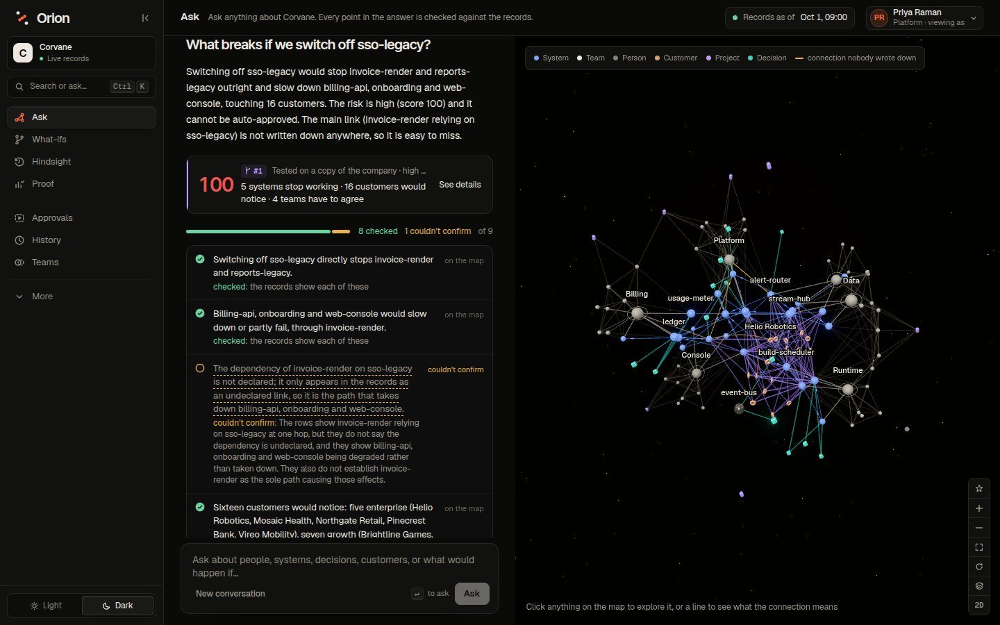

## Tracks

Orion is entered in **all three tracks**.

| Track | What Orion does for it |
|---|---|
| **01 Agents That Act on Connected Data** | The Navigator answers by calling graph tools (multi-hop traversal, WCC, betweenness, PageRank, label propagation, shortest paths) and acts by forking universes. Each sentence it says carries a typed claim the graph checks. The same tools are on an MCP server. |
| **02 Agent Memory and Coordination** | One memory graph per person (turns, versioned beliefs, learned tool sequences). Agents coordinate on a shared board in its own graph: tasks claimed atomically, chained with `FOLLOWS`, released when a worker stops heartbeating. A change one agent applies re-checks the answers another gave. |
| **03 Company Brain** | People, teams, systems, customers, tickets, decisions, chat and documents in one bi-temporal graph. Who owns what and who actually knows it, decisions traced to the messages behind them, blame on every fact, the company on any past date, and any public GitHub repository loaded the same way. |

## What no one else will show you

**The safe path.** A what-if says what a change breaks. Orion also looks for an order of steps that leaves no modeled
problem, and says what it won't do. Ask it to switch off sso-legacy and it searches parallel copies of the company: for
every system that would stop working, it tries moving it onto a replacement it has evidence for (a successor a decision
names, `(identity)-[:REPLACES]->(sso-legacy)` from ADR-005, or a system others already moved to) or switching it off
too when no system relies on it (its customers still count). Candidates that only share a team or a decision are turned
down, with the reason. Each try is a full `GRAPH.COPY` of the company with the plan applied, scored like a what-if; a
beam search keeps the safest few at each step. On Corvane it explores 16 companies (about a second on a local FalkorDB,
about ten on the free cloud instance, where copies take turns) and comes back with: move invoice-render onto identity,
which waits on BILL-207 and the IDN-58 endpoint it is blocked by, move reports-legacy onto identity, then switch off
sso-legacy. Modeled risk 100 → 0 once those tickets land, which means nothing the model can see, not a guarantee; the
plan lists what it rests on. One click sends it to the teams it touches. The Navigator has it as a tool too
(`safe_path`).

**Hindsight: would Orion have caught it?** Every incident is replayed against the decision that led to it. INC-311
(invoices stopped rendering for every customer) came 15 days after ADR-011 approved retiring sso-legacy. Orion rebuilds
the company as it stood on 3 March 2026 and tests the decision twice: on what had been written down that day (risk 26,
one supporting system) and on what was true (risk 100, five systems, all 16 customers). The difference is one
dependency that had been true for 652 days and was written down 6 days after the outage, and Orion shows the message
that finally recorded it. Then the safe path on that day: its first step is exactly the fix the company made months
later (BILL-207).

**Proof.** 29 questions generated from the graph, so each has an answer the records settle (who actually knows a
system, what it relies on at any depth, what breaks and how many, whether a decision still holds). The same model
answers them twice: as Orion, and reading the 15 most relevant records as a retrieval assistant would. Graded the same
way: **Orion 97% correct (28/29), the same model reading the records 28% (8/29)** in the run on the Proof screen.
Over three runs, Orion scored 24 to 28 (90% overall) and the baseline 5 to 8 (23%). Read by hand, eight of Orion's nine
misses across the runs were the strict grader (a negation, the first of several numbers, a name in a side remark) and
one was a real mistake. The questions come from the graph and the baseline is keyword retrieval, so this measures
graph-shaped questions, not accuracy in general. Every question and both answers are on the Proof screen; rerun it with
`uv run python -m orion.evals`.

| | | |
|---|---|---|
| 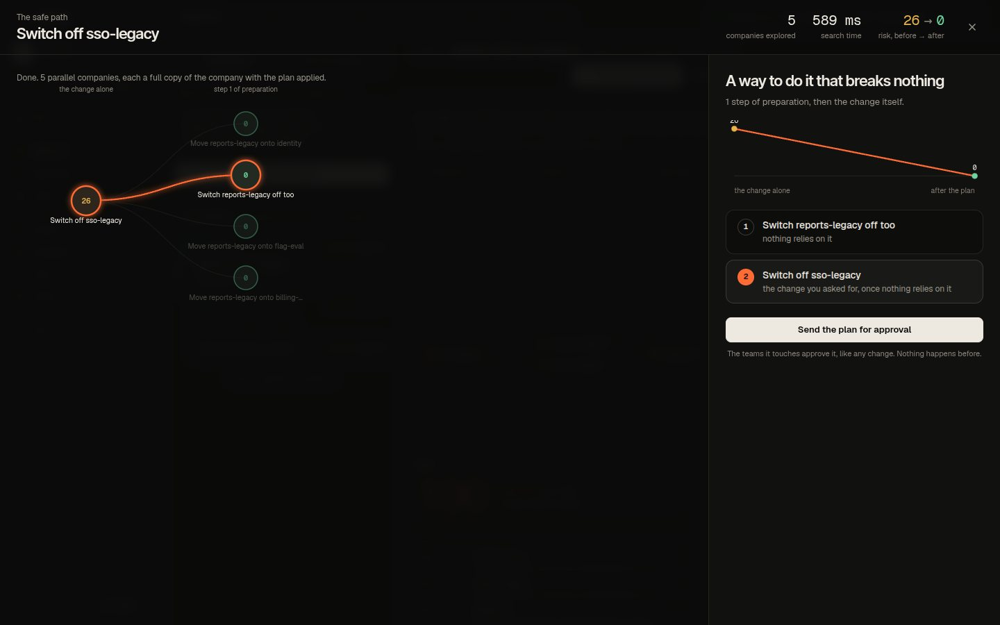 | 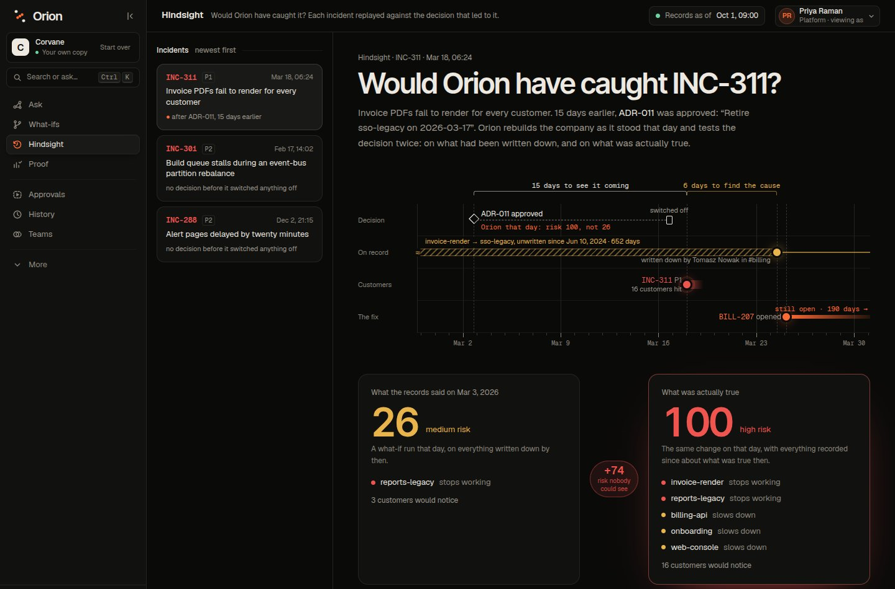 | 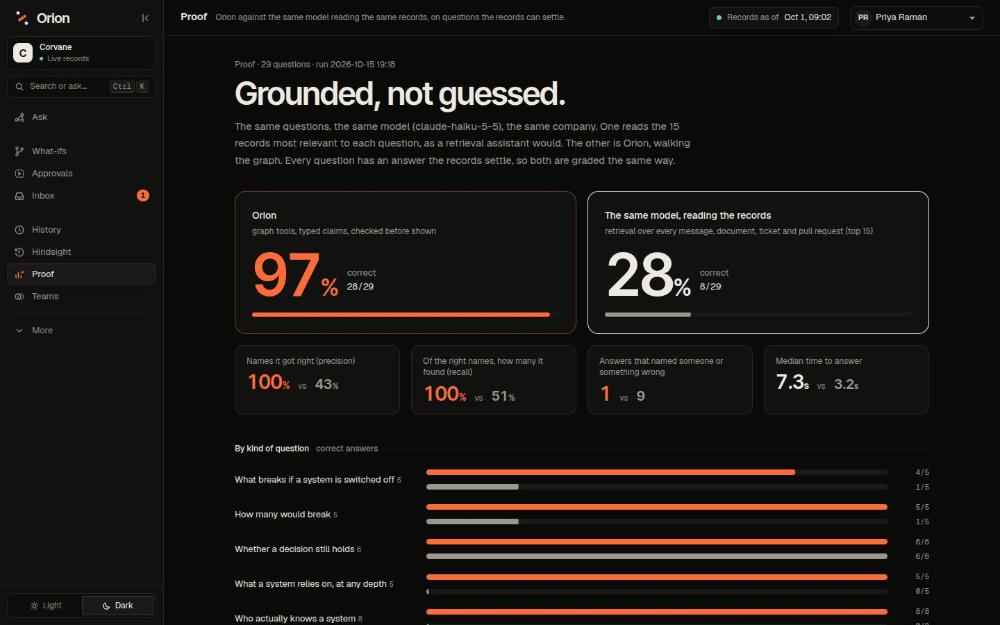 |
| **The safe path.** Every company explored appears in the tree as it is scored; the winning branch lights up and the plan reads out with the risk falling step by step. | **Hindsight.** The decision, the incident, the day the missing fact was written down and the day the fix landed, then what the records said against what was true. | **Proof.** The head-to-head, by kind of question, with every question open to both answers. |

## The story it tells

Corvane is a fictional developer-platform company: 40 people, six teams, 26 systems, 16 customers, two years of
history. Its data is generated, but its problems are the usual ones.

> *"What breaks if we switch off sso-legacy?"*

The Navigator forks the company, switches sso-legacy off in the copy and compares it with the real one.
invoice-render and reports-legacy stop working; billing-api, onboarding and web-console slow down through
invoice-render; all 16 customers touch something that breaks; Billing, Console, Data and Platform must agree. Risk
100. invoice-render breaks through a dependency **the service catalog never listed**: it was found in a #billing
message after the last attempt to retire sso-legacy took invoicing down (INC-311). Each sentence is a typed claim,
and each shows **checked** because the graph returned exactly that.

Then Tomasz posts in #billing: *"BILL-207 is merged: invoice-render now gets its signing token from identity. It no
longer calls sso-legacy at all."* The Cartographer reads two changes of fact out of the message. The Sentinel sees
that Tomasz is on Billing, which owns invoice-render, and applies both, with the message as their source. Every
stored answer that relied on the old dependency is checked again with no model call. Three of Priya's eight points
turn **no longer true**, and her inbox says what changed. Switching sso-legacy off now breaks only reports-legacy:
risk 26.

| | |
|---|---|
| 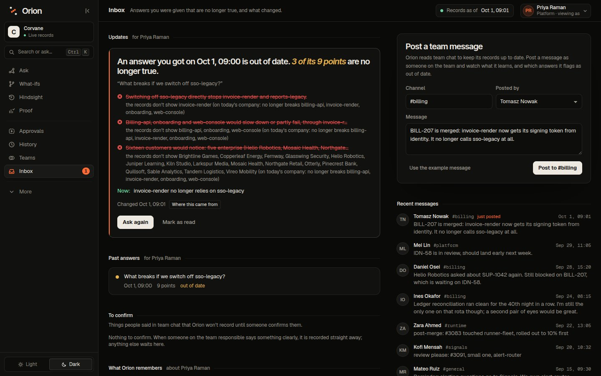 | 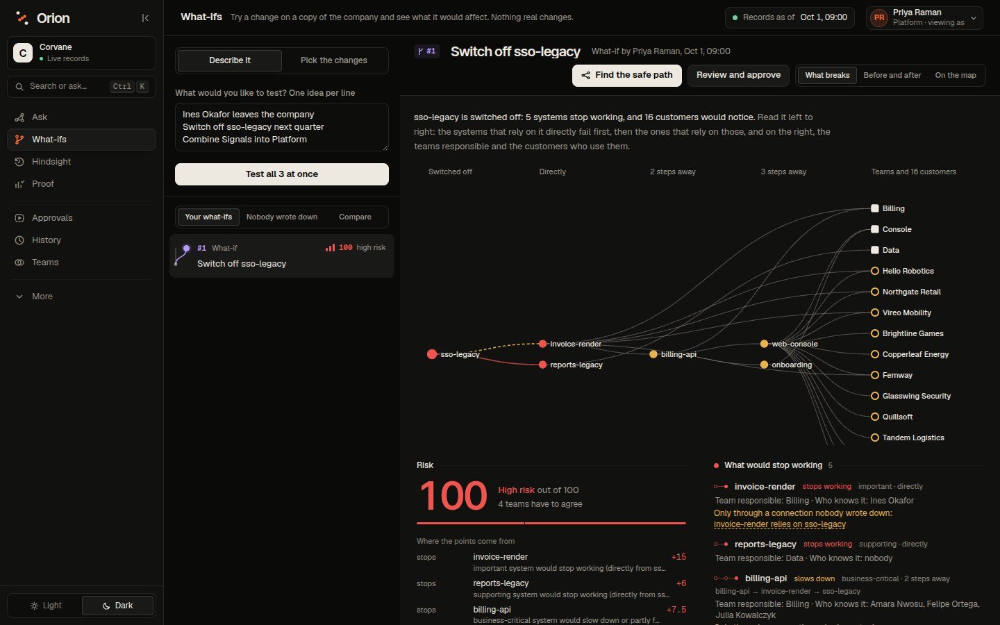 |
| **Inbox.** An answer that stopped being true, the points that broke, and the message that changed them. | **What-if.** What stops working, step by step from the change, who is responsible, which customers would notice, and where each risk point comes from. |
| 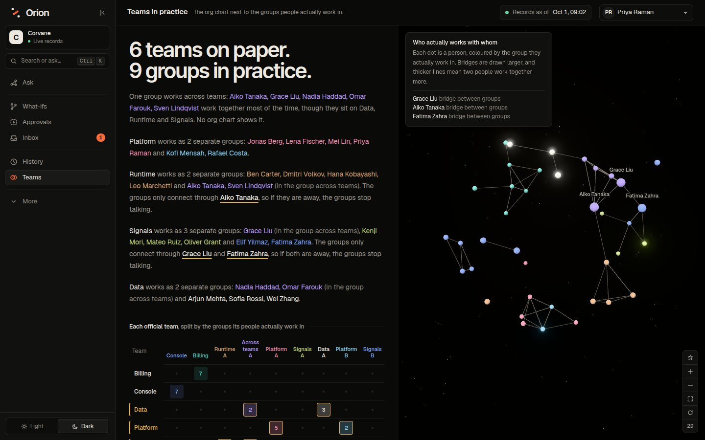 | 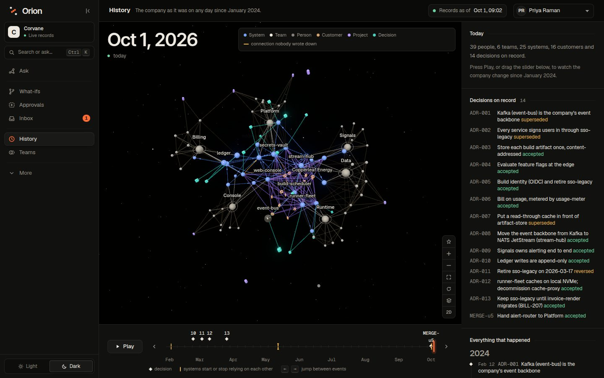 |
| **Teams in practice.** Six teams on paper, nine groups in practice, and one group that works across Runtime, Data and Signals that no org chart shows. | **History.** The company on any date since January 2024. Forking the same change on 2 March 2026 gives risk 26 with what was written down that day and 100 with what was true. INC-311 followed two weeks later. |
| 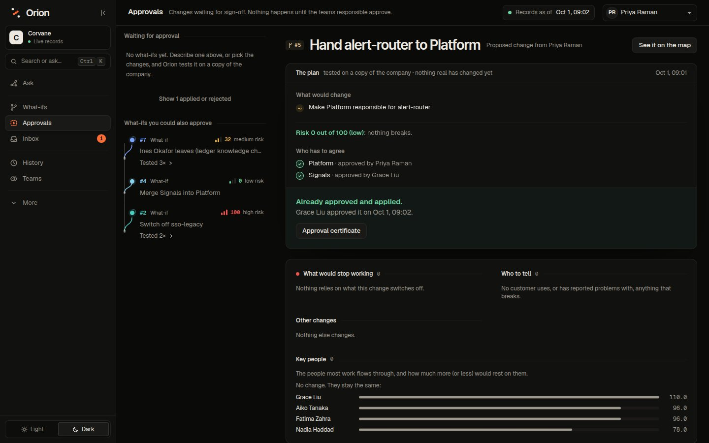 | 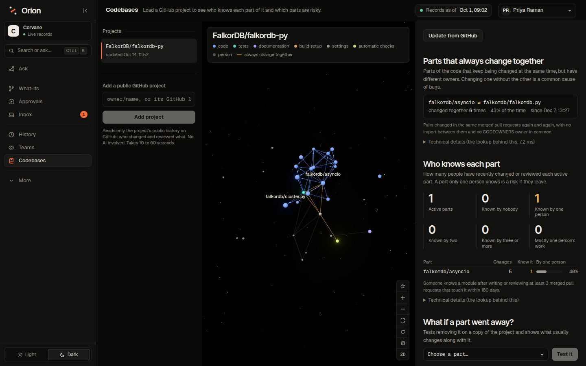 |
| **Approvals.** Nothing changes until every team the change touches agrees; then it is merged into the records with a certificate. | **Codebases.** Any public GitHub repository as a company: modules that keep changing together with no import between them, and how thinly each one is known. |

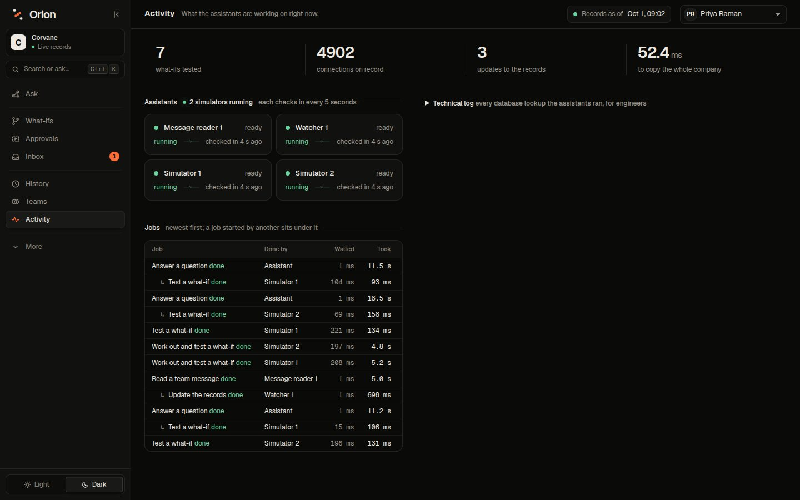

## How the graph does the work

Every screen is a query, a traversal or an algorithm over FalkorDB.

| What | FalkorDB feature |
|---|---|
| A universe per question | `GRAPH.COPY` of today's company, then the change edits the copy in place (a median of about 60 ms for Corvane's 1,700 nodes and 5,000 relationships) |
| The company on any date | `GRAPH.COPY` of the bi-temporal org graph, pruned to the date; derived relationships recomputed for it |
| Many graphs in one instance | `org:`, `epoch:`, `universe:`, `mem:` (one per person), `deck:` |
| What breaks, at any depth | Breadth-first walk up `DEPENDS_ON`, one indexed query per hop, keeping the worst effect and a witness path |
| Systems that lose every path to a team | `algo.WCC` over `DEPENDS_ON`, `KNOWS`, `MEMBER_OF`, `OWNS` |
| Working groups that would come apart | `algo.WCC` over `COLLABORATES` |
| The groups people actually work in | `algo.labelPropagation` over each person's closest recent ties, seven runs, pairs most runs agree on |
| The people everything flows through | `algo.betweenness` over `COLLABORATES` |
| Knowledge hubs | `algo.pageRank` |
| How two things are connected | `allShortestPaths` over the structural relationships |
| Names as people write them | Full-text indexes on `Alias` and `Source` |
| Tools that can't write | Every read tool runs through `GRAPH.RO_QUERY` |
| Atomic task claims between agents | One write query; writes to a graph are serialized |
| The safe path | Beam search where every candidate plan is a `GRAPH.COPY` of the company (now, or on a past date) with the plan applied, scored by the same traversal and algorithms as a what-if |
| Hindsight | Two epochs of the same past day, `true` and `known` (facts filtered on `recorded_at`), diffed on the decision's change; the blind spot is the facts on the breakage paths recorded after that day |
| Which answers a change affects | `Claim.facts` (the facts it relied on) and `(:Claim)-[:READ]->(node)`: one traversal from what changed |
| The work behind each answer | Every query is counted against the agent task it ran for (and the tasks it handed on), so each answer ends with the graphs it touched, its query and copy counts, and its time in FalkorDB |

**Graph data model:** [docs/graph-model.md](docs/graph-model.md).
**Every named Cypher query:** [docs/queries.md](docs/queries.md) (generated by `uv run python -m orion.docgen`).

## Agents

| Agent | Job | Model |
|---|---|---|
| **Navigator** | Plans, calls graph tools (several at once), forks universes, answers with typed claims citing evidence | yes |
| **Verifier** | Checks each typed claim against the graph: exact set or number. Free text is only ever *judged* by a model on the rows it cites | rules, model for free text |
| **Simulator 1 and 2** | Take what-ifs from the board (in plain words or as typed changes), fork, diff, score risk | to read plain words |
| **Cartographer** | Reads a new message and proposes the changes of fact it states; plans, questions and jokes propose nothing | yes |
| **Sentinel** | Weighs who said it (the owning team 0.95, anyone else 0.65, hedging ×0.7), then applies, queues for the owning team, or records a contradiction; re-checks affected answers and tells whoever asked | no |

Typed claims: `breaks`, `orphans`, `approvers`, `knows`, `owns`, `depends_on`, `decided`, `count`, `metric`. A
sentence is held to its claim: "only", "all" or "nobody else" make a set claim exhaustive whatever the model typed;
a sentence that names something its check didn't cover is **partly checked**; a name that matches nothing is
**unsupported**, never "not true".

Models: Claude Haiku 5.5 by default (`ORION_LLM=anthropic`), or Gemini (`ORION_LLM=gemini`). Without a key,
everything except asking and reading new messages in plain words still works.

## Run it

Requirements: Docker, [uv](https://docs.astral.sh/uv/), Node 22 and pnpm.

```bash
git clone https://github.com/Sumit99589/orion && cd orion
docker compose up -d falkordb                # FalkorDB on :6379, FalkorDB Browser on :3000

cd backend
cp .env.example .env                         # add ANTHROPIC_API_KEY (or GEMINI_API_KEY with ORION_LLM=gemini)
uv sync
uv run orion reset                           # load Corvane
uv run uvicorn orion.api:app --port 8100

cd ../web                                    # in another terminal
cp .env.example .env.local
pnpm install && pnpm dev --port 3001         # open http://localhost:3001
```

Or everything in Docker: `docker compose --profile full up -d --build` (web on :3001). Deploying to Vercel, Render
and FalkorDB Cloud: [docs/deploy.md](docs/deploy.md).

Pick a person to act as from the top-right menu; there are no passwords in the demo, but the server signs a token
for that person and takes the author of every action from it. Switch people to approve as another team, or to post
a message as someone on the team.

From the command line:

```bash
uv run orion fork "deprecate_service service=sso-legacy"       # what breaks, who would notice, who agrees, risk
uv run orion fork "remove_person person=Ines Okafor"           # nobody would know the ledger
uv run orion departures                                        # everyone ranked by what their leaving would cost
uv run orion approve u1 person:priya-raman                     # approve as Priya (Platform)
uv run orion message "invoice-render no longer calls sso-legacy" --author person:tomasz-nowak
uv run orion repo FalkorDB/falkordb-py                         # load a public repository (needs GITHUB_TOKEN)
uv run pytest -q                                               # 62 tests, incl. the equivalence property test
```

### Codebases (any public GitHub repository)

Paste `owner/repo` on the Codebases screen. Merged pull requests of the last year come from GitHub's GraphQL API (a
page of 25 with their files and reviews per call), the source at HEAD from the tarball. Contributors become people,
top-level parts of the code become modules, CODEOWNERS entries become teams, imports between modules become
dependencies (each with the line it came from), and modules that keep changing in the same pull requests get
`CO_CHANGES`. "Update from GitHub" folds in what merged since, and import changes go through the Sentinel like a
message would. Knowledge is shown as counts per module, never as a person at risk.

### MCP (Claude Desktop, Cursor)

```json
{
  "mcpServers": {
    "orion": {
      "command": "uv",
      "args": ["--directory", "/path/to/orion/backend", "run", "python", "-m", "orion.mcp_server"],
      "env": { "ORION_USER": "person:priya-raman" }
    }
  }
}
```

The read-only graph tools, `what_if` (fork, nothing changes), `propose` (a change that needs approval) and
`approve`, which acts as `ORION_USER` and refuses proposals made through MCP: an agent can propose a change but never
wave its own through.

## What's checked

| Check | How |
|---|---|
| Merging a universe gives the company the universe showed | Property test: 30 random lists of changes, merged into the records then rebuilt, compared down to WCC, betweenness, PageRank and impact (`tests/test_equivalence.py`) |
| The storylines | Ghost dependency, backtest, bus factor, approvals, blocked merges, rebase, rejected universes (`tests/test_universe.py`) |
| Claims | Exhaustive wording, partly checked sentences, unknown names, what-if claims, customers, orphans, approvers, decisions (`tests/test_claims.py`) |
| The live loop | A change re-checks exactly the claims that relied on it; authority, review, hedging; memory per person; tokens; atomic task claims (`tests/test_live.py`) |
| The safe path and hindsight | The plan for sso-legacy moves invoice-render onto identity first and ends at risk 0; INC-311's blind spot is the invoice-render dependency, written down by Tomasz six days after the outage (`tests/test_planner.py`) |
| Answers against a baseline | 29 graph-generated questions, Orion against the same model reading the records (`orion/evals.py`, results in `orion/eval_results.json`) |
| Codebases | Imports across Python, TypeScript, Go, Rust, C and Java; CODEOWNERS; module layout; co-changes (`tests/test_repo.py`, offline) |

## Data

All Corvane data is synthetic, generated from a fixed seed (`backend/src/orion/world/`). Its storylines are a ghost
dependency, a reversed decision, a bus factor of one, systems nobody knows, a wiki that disagrees with who actually
runs a system, a group that works across three teams, two records that disagree, a customer blocked three tickets
deep, and a retired system. No real people or private data are used. Repository tenants contain only public GitHub
metadata.

## AI use

Orion was built with an AI coding assistant (Claude, in Claude Code), as Graph Hacks rule 11 asks us to disclose.
The author designed the product and the graph model, directed the work, and reviewed and tested what was written;
the assistant wrote much of the code under that direction. At run time the agents call Claude Haiku 5.5 or Gemini, as
described above. Corvane's data is generated by code, not by a model.

## Layout

```
backend/src/orion/
  world/          Corvane: org, systems, storylines, generated history
  load.py         the org graph: facts with validity, sources, aliases, mentions
  epoch.py        the company on a date (GRAPH.COPY + prune + derive)
  ops.py          typed changes: physical (universe) and temporal (merge) interpreters
  universe.py     fork · diff · risk · approve · rebase · merge · reject
  impact.py       dependency traversal at any depth, with witness paths
  claims.py       typed claims checked by the graph
  tools.py        graph tools with evidence, shared by agents, API and MCP
  agents/         navigator · verifier · simulator · cartographer · sentinel
  blackboard.py   the agents' shared board: tasks, workers, heartbeats
  memory.py       per-person memory graphs
  departures.py   if they left tomorrow
  planner.py      the safe path: beam search over parallel companies
  hindsight.py    incidents replayed against the decision before them
  evals.py        Orion against the same model reading the records
  github.py · repo.py    codebases: GitHub ingest, insights, sync
  api.py · security.py · mcp_server.py · cli.py · docgen.py
web/              Next.js: ask, what-ifs (and the safe path), approvals, inbox, history, hindsight, proof, teams,
                  activity, codebases
docs/             graph model, queries, deploy
```
