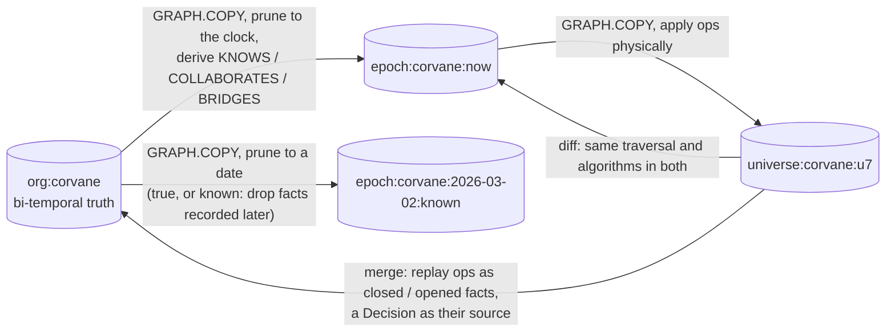
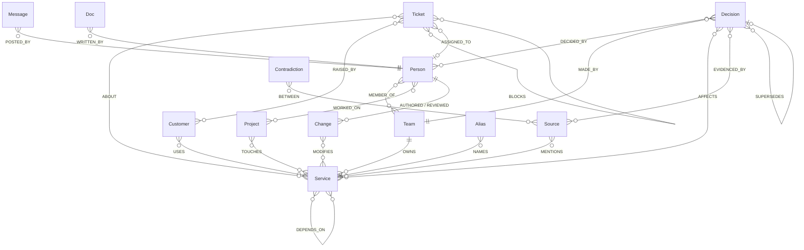
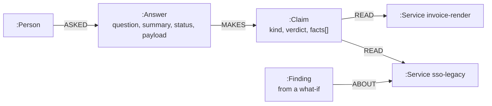

# Graph model

One FalkorDB instance holds every graph Orion uses. Each graph has one job, and its name says which.

| Graph | Holds | Time | Lives |
|---|---|---|---|
| `org:<tenant>` | The company: people, teams, services, customers, projects, decisions, sources (messages, documents, tickets, pull requests), answers, claims, findings | Bi-temporal relationships; nothing is deleted, facts are closed | Always |
| `epoch:<tenant>:now` | The company as it is now | Physically pruned to the tenant's clock | Rebuilt when the org graph changes |
| `epoch:<tenant>:<date>:<true\|known>` | The company on a date, as it really was or as it was known | Physically pruned to that date | Rebuilt when the org graph changes |
| `universe:<tenant>:<id>` | A fork with changes applied | Physically edited copy of `epoch:now` | Until merged or discarded |
| `mem:<tenant>:<person>` | One person's memory: sessions, turns, beliefs, procedures | Append-only, beliefs bi-temporal | Always |
| `deck:<tenant>` | The agents' board: tasks, universe registry, approvals, reviews, notifications | Append-only | Always |
| `orion:pool` | The agents themselves, with heartbeats | Current | Always |



## Why epochs and universes are physical copies

The algorithms Orion uses (`algo.WCC`, `algo.betweenness`, `algo.pageRank`, `algo.labelPropagation`)
filter by node label and relationship type, never by property. A dependency with `valid_to` in the past would still
be walked. So the org graph stays bi-temporal, and everything an algorithm runs on is a `GRAPH.COPY` that has been
physically edited:

- relationships not valid on the date are deleted (in `known` mode, so are those recorded after it);
- sources, decisions, tickets, people, services and customers from after the date are deleted, and statuses are
  rewound (a decision superseded later is `accepted` again);
- people who had left become `:Former`, retired services `:Retired`, dissolved teams `:FormerTeam`, so label filters
  skip them;
- derived relationships are computed for that date (below).

A universe is a copy of `epoch:now` edited the same way by the physical interpreter of each op. Copying Corvane
(about 1,700 nodes and 4,800 relationships) takes about 40 milliseconds, so every question can have its own universe.

## The company (`org:<tenant>`)



Labels: `Person`, `Team`, `Service`, `Customer`, `Project`, `Decision`, `Contradiction`, `Alias`, and sources with
two labels each: `Source:Message`, `Source:Doc`, `Source:Ticket`, `Source:Change`. Every node has a `uid` with a
range index; uids survive `GRAPH.COPY`, so diffs and citations are stable across graphs. A full-text index covers
`Source.text` and `Source.title`, another covers `Alias.text` (nicknames like "the old sso", first names, handles).

### Facts with validity

Everything that can stop being true is a relationship with:

| Property | Meaning |
|---|---|
| `uid` | Stable id of the fact |
| `valid_from`, `valid_to` | When it was true; `valid_to = '9999-12-31'` while it still is |
| `recorded_at` | When Corvane learned it. The ghost dependency was true from 2024-06-10 and recorded on 2026-03-24 |
| `src` | The uid of the source it came from: the service catalog, the HR export, a message, or a `Decision` for merged changes |
| `closed_by` | The source or decision that ended it |

These are `MEMBER_OF`, `OWNS` (with `declared`), `DEPENDS_ON` (with `kind`: `sync`, `async` or `data`), `USES` and
`WORKED_ON`. Nodes carry their own lifetimes: `Person.joined/left`, `Service.created/retired`, `Team.dissolved`.
**Blame** is the fact's `src`; **checkout** is an epoch; **as known** filters on `recorded_at`.

### Derived relationships (computed per epoch)

| Relationship | Rule |
|---|---|
| `(:Person)-[:KNOWS {n, last_at}]->(:Service)` | 3 or more changes authored or reviewed in the 180 days before the date |
| `(:Person)-[:COLLABORATES {w}]-(:Person)` | Shared changes, 2 points each, decaying with a 90-day half-life; kept from 3 points; both directions |
| `(:Person)-[:BRIDGES]-(:Person)` | `COLLABORATES` between people on different teams |
| `(:Person)-[:CLOSE]->(:Person)` | Each person's two strongest ties of the last 120 days; label propagation over it gives `Person.group` |
| `(:Team)-[:OWNS {declared: false, share}]->(:Service)` | De facto owner: the team whose people made at least half the system's recent changes, when that isn't the declared owner |

### Answers and claims



Every claim keeps the uids of the facts its evidence rested on (`facts`) and a `READ` edge to every node it
looked at. When the Sentinel closes a fact, one query finds the claims whose `facts` contain it; when it touches a
node, one traversal back along `READ` finds the rest. Each answer found is checked again by the graph (no model
call), only claims whose check now fails change, and the asker gets a notification. Anyone watching a question
hears whenever any of its marks moves. Findings are what earlier what-ifs learned, attached to the entities they
are about, so the next question about them (from anyone) starts there, and is re-run if something it relied on
changed since.

## Memory (`mem:<tenant>:<person>`)

```
(:User)-[:HAD]->(:Session)-[:TURN]->(:Turn {role, text, at, answer_uid})-[:ABOUT]->(:Ref {uid, name})
(:User)-[:BELIEVES]->(:Belief {key, text, valid_from, valid_to, confirmed_at})-[:LEARNED_FROM]->(:Turn)
(:Belief)-[:SUPERSEDES]->(:Belief)
(:User)-[:PREFERS]->(:Preference {key, value})
(:Procedure {name, qtype, tools, successes, failures})-[:STEP {i}]->(:Step {tool})
```

One graph per person, and the person is always the one in the signed token: nobody can read another person's memory.
Recall for a new question is this conversation's last turns plus earlier turns about the same entities (a join on
`Ref`). A new text for a belief's key closes the old one and supersedes it, so every version stays; confidence halves
every 120 days until the belief is stated again; sessions older than two weeks are folded into one summary belief
each. A tool sequence that produced checked answers twice for a kind of question becomes a playbook, and its read
tools are run before the next answer of that kind.

## The deck (`deck:<tenant>`) and the pool (`orion:pool`)

```
(:Agent {name, role, pid, status, heartbeat_at, kinds})                       in orion:pool, shared by all tenants
(:Task {uid, kind, status, payload, claimed_by, attempts, root, created_at, claimed_at, done_at})-[:FOLLOWS]->(:Task)
(:Task)-[:PRODUCED]->(:Finding {summary})
(:Universe {uid, graph, base, kind, title, ops_json, diff_json, risk, risk_level, status, base_version,
            required_json, decision, opened_facts, closed_facts})-[:NEEDS]->(:Approval {by, team, verdict, at})
(:Review {change, source_uid, author_uid, confidence, why, status})
(:Notification {user, answer_uid, broken_claims, reasons, fact, source_uid, kind, read})
```

A task is claimed with one write query, and FalkorDB runs writes to a graph one at a time, so racing workers never
take the same task (`tests/test_live.py`). A task is tried at most three times; one claimed by a worker that stopped
heartbeating goes back on the board.

## Codebases (`org:gh-<owner>--<repo>`)

A public repository loads into the same model, so every tool, check and screen works on it:

| Repository | Graph |
|---|---|
| contributor | `:Person` (bots skipped) |
| top-level part of the code (opened up where one directory holds most of the work) | `:Service {kind: code, test, docs, ci, build or config}` |
| merged pull request, its author and reviewers, the modules it touched | `:Source:Change`, `AUTHORED`, `REVIEWED`, `MODIFIES` |
| CODEOWNERS entry | `:Team`, `OWNS {declared: true}`, `MEMBER_OF` for individual owners |
| import between modules at HEAD | `DEPENDS_ON {declared: true, quote}` with a `:Source:Doc {kind: code}` for the line it came from |
| modules changed together in several pull requests | `CO_CHANGES {together, jaccard, since}` |
