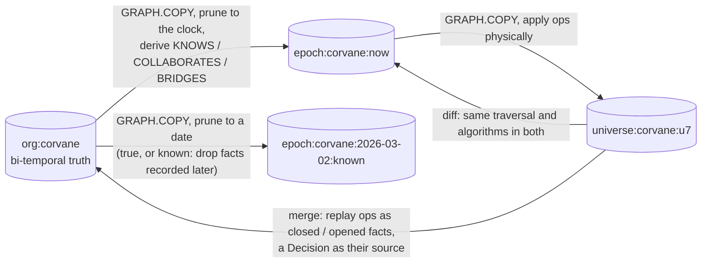
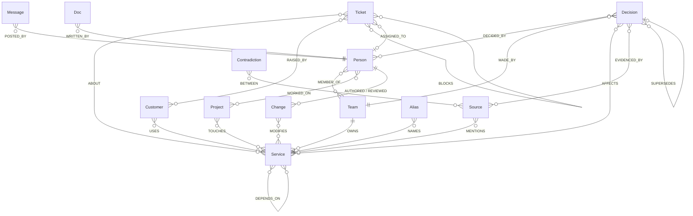
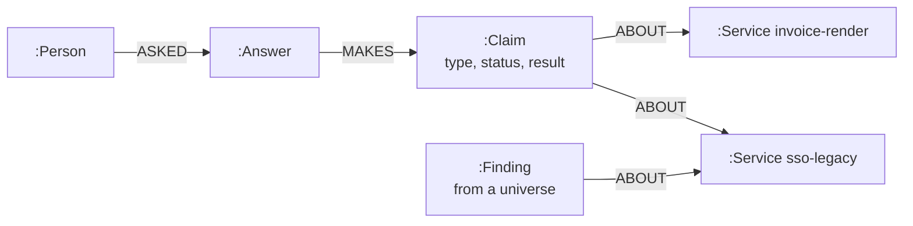

# Graph model

One FalkorDB instance holds every graph Orion uses. Each graph has one job, and its name says which.

| Graph | Holds | Time | Lives |
|---|---|---|---|
| `org:<tenant>` | The company: people, teams, services, customers, projects, decisions, sources (messages, documents, tickets, pull requests), answers, claims, findings | Bi-temporal relationships; nothing is deleted, facts are closed | Always |
| `epoch:<tenant>:now` | The company as it is now | Physically pruned to the tenant's clock | Rebuilt when the org graph changes |
| `epoch:<tenant>:<date>:<true\|known>` | The company on a date, as it really was or as it was known | Physically pruned to that date | Rebuilt when the org graph changes |
| `universe:<tenant>:<id>` | A fork with changes applied | Physically edited copy of `epoch:now` | Until merged or discarded |
| `mem:<tenant>:<person>` | One person's memory: sessions, turns, beliefs, procedures | Append-only, beliefs bi-temporal | Always |
| `deck:<tenant>` | The agents' board: agents, tasks, universe registry, approvals, reviews, notifications | Append-only | Always |



## Why epochs and universes are physical copies

The algorithms Orion uses (`algo.WCC`, `algo.betweenness`, `algo.pageRank`, `algo.labelPropagation`, `algo.MSF`)
filter by node label and relationship type, never by property. A dependency with `valid_to` in the past would still
be walked. So the org graph stays bi-temporal, and everything an algorithm runs on is a `GRAPH.COPY` that has been
physically edited:

- relationships not valid on the date are deleted (in `known` mode, so are those recorded after it);
- sources, decisions, tickets, people, services and customers from after the date are deleted, and statuses are
  rewound (a decision superseded later is `accepted` again);
- people who had left become `:Former`, retired services `:Retired`, dissolved teams `:FormerTeam`, so label filters
  skip them;
- derived relationships are computed for that date (below).

A universe is a copy of `epoch:now` edited the same way by the physical interpreter of each op. Copying Corvane
(about 1,700 nodes and 4,700 relationships) takes tens of milliseconds, so every question can have its own universe.

## The company (`org:<tenant>`)



Labels: `Person`, `Team`, `Service`, `Customer`, `Project`, `Decision`, `Contradiction`, `Alias`, and sources with
two labels each: `Source:Message`, `Source:Doc`, `Source:Ticket`, `Source:Change`. Every node has a `uid` with a
range index; uids survive `GRAPH.COPY`, so diffs and citations are stable across graphs. A full-text index covers
`Source.text` and `Source.title`, another covers `Alias.text` (nicknames like "the old sso", first names, handles).

### Facts with validity

Everything that can stop being true is a relationship with:

| Property | Meaning |
|---|---|
| `uid` | Stable id of the fact |
| `valid_from`, `valid_to` | When it was true; `valid_to = '9999-12-31'` while it still is |
| `recorded_at` | When Corvane learned it. The ghost dependency was true from 2024-06-10 and recorded on 2026-03-24 |
| `src` | The uid of the source it came from: the service catalog, the HR export, a message, or a `Decision` for merged changes |
| `closed_by` | The source or decision that ended it |

These are `MEMBER_OF`, `OWNS` (with `declared`), `DEPENDS_ON` (with `kind`: `sync`, `async` or `data`), `USES` and
`WORKED_ON`. Nodes carry their own lifetimes: `Person.joined/left`, `Service.created/retired`, `Team.dissolved`.
**Blame** is the fact's `src`; **checkout** is an epoch; **as known** filters on `recorded_at`.

### Derived relationships (computed per epoch)

| Relationship | Rule |
|---|---|
| `(:Person)-[:KNOWS {n}]->(:Service)` | 3 or more changes authored or reviewed in the 180 days before the date |
| `(:Person)-[:COLLABORATES {w}]-(:Person)` | Shared changes, 2 points each, decaying with a 90-day half-life; kept from 3 points; both directions |
| `(:Person)-[:BRIDGES]-(:Person)` | `COLLABORATES` between people on different teams; WCC over it finds teams the org chart doesn't show |

### Answers and claims



When a fact changes, one traversal from the touched entities back along `ABOUT` reaches every claim that relied on
them, and each is checked again by the graph. Findings are what earlier simulations learned, attached to the entities
they are about, so the next question about them (from anyone) starts there.

## Memory (`mem:<tenant>:<person>`)

```
(:User)-[:HAD]->(:Session)-[:TURN]->(:Turn {role, text, at})-[:ABOUT]->(:Ref {uid})
(:Turn {role: 'user'})-[:ANSWERED_BY]->(:Turn {role: 'assistant'})
(:User)-[:BELIEVES]->(:Belief {text, valid_from, valid_to})-[:ABOUT]->(:Ref)
(:Procedure {qtype, tools, successes, failures})
```

One graph per person, and the person is always the one in the signed token: nobody can read another person's memory.

## The deck (`deck:<tenant>`)

```
(:Agent {name, role, status, beat})
(:Task {uid, kind, status, payload, result, attempts, agent})-[:FOLLOWS]->(:Task)
(:Universe {uid, graph, kind, ops, diff, risk, level, status, required, base_version, applied, decision})
(:Approval {universe, team, by, at})
(:Review {change, source, author, authority, team, status})
(:Notification {user, answer, claim, before, after, cause, read})
```

A task is claimed with one write query, and FalkorDB runs writes to a graph one at a time, so racing workers never
take the same task (`tests/test_live.py`).
